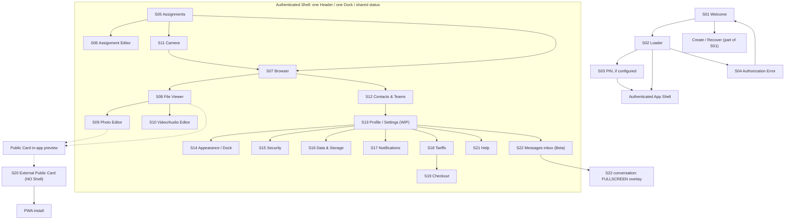
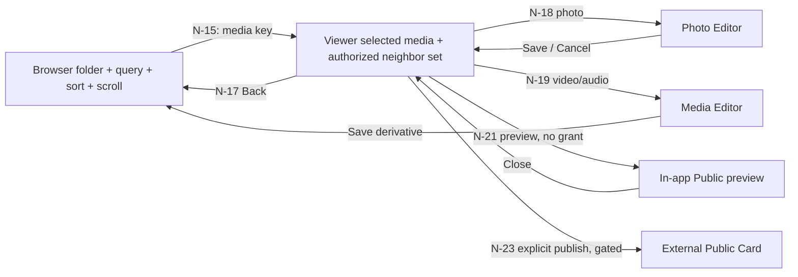

# PB3 navigation map — cross-screen UX graph

**Baseline:** imported PB2 PR #56, frozen source `daca24a4`; PB3 runtime at Draft #134 `07fa2832`. **Important:** arrow = accepted UX requirement or proposed integration, *not proof of implementation*. Use the **Evidence** column below to distinguish actual route availability. IDs are stable for test references.

## Global structure

- Diagram compresses links for clarity. It is **not** a complete directed-graph implementation specification; use numbered edges below.
- Internal Public Card **preview** is a *layer* of S08, **not** S20 external public publication. Sending one encrypted file to a user is *not* creating a public link. **Browser Share of multiple files/whole assignment is OPEN**.
- S22 inbox is normal Shell content; **conversation overlay covers Header, main and Dock on desktop and mobile**. Close it to restore the same inbox scroll and selection. The entry/return behavior when opened from a *different* screen (S13/S12) must be reconciled — see GAP-04.

## Numbered edges

**Evidence legend:** `R` = matching PB3 route/entry evidenced in Draft #134; `P` = partial path inside a view but not canonical integrated UX; `T` = approved/selected UX target, not a verified route; `O` = open or nonfinal design; `D` = demo-only link, **must not** be treated as a working application transition.

| Edge | From → To | Trigger; required context; return rule | Evidence | UX source |
|---|---|---|---|---|
| N-01 | S01 → S01 create/recover | Welcome create/recover actions; user chooses key-only flow, without email/password | T | [Welcome](../ux/welcome/README.md) |
| N-02 | S01 → S02 → Shell | Loader state of same Welcome, preserve layout; network timeout is not deleted-account evidence | T | [Loader](../ux/welcome/loader/README.md) |
| N-03 | S02 → S03 → Shell | Configured PIN gate before protected content; local-first permitted but ACL still enforced | T | [PIN](../ux/pin-shell/README.md) |
| N-04 | Auth failure → S04 → S01 | Only confirmed failure; error screen has exactly one Welcome link, no Header/Dock | T | [Authorization Error](../ux/authorization-error/README.md) |
| N-05 | Shell Dock → S05/S07/S11/S12/S13 | Default 5 entries; configurable 3–6, mandatory movable Profile/Settings, one-level active-tap back | R/P | [Appearance 1.3](../ux/app-appearance/README.md) · [Shell](../ux/UI-SHELL-CONTRACT.md) |
| N-06 | S05 → S06 | Create/edit assignment; correct ID, owner/role, draft and no forbidden operation; return to same list context | R/P | [Assignments 5](../ux/assignments/v5/README.md) · [Editor 2.2](../ux/assignments/editor/README.md) |
| N-07 | S05 → S11 | "Снимать / Записать" scoped to selected assignment, allowable media types, schedule, role and GPS requirements; return to relevant assignment | R/P | [Assignments 5](../ux/assignments/v5/README.md) · [Camera](../ux/camera/README.md) |
| N-08 | S05 → S07 | "Browser" filtered to **that** assignment and authorized files; restore previous filter on Back | T/P | [Assignments](../ux/assignments/README.md) · [Browser](../ux/browser/README.md) |
| N-09 | S05 → assignment detail | "Открыть" presents detail; **no accepted standalone detail design**; do not invent a route | O/P | [Assignments 5](../ux/assignments/v5/README.md) |
| N-10 | S06 → S12 | "Перейти к настройкам команд", with return to same assignment editor draft and tab; avoid accidental data loss | T | [Assignment Editor](../ux/assignments/editor/README.md) · [Contacts & Teams](../ux/contacts-teams/README.md) |
| N-11 | S06 → people picker | Add participant from Contacts/lookup; eligibility, team/role; picker is sheet/subflow, not an independent accepted screen | T/P | [Assignment Editor](../ux/assignments/editor/README.md) |
| N-12 | S06 → S11 | Camera preset / camera settings; preserve editor draft and return context | T | [Assignment Editor](../ux/assignments/editor/README.md) |
| N-13 | S06 rules → S20 policies | Assignment Public Card switches define **maximum** allowed fields; **no external publication** by turning switches on | T | [Assignment Editor](../ux/assignments/editor/README.md) · [Public Card](../ux/public-card/README.md) |
| N-14 | S11 → S07 | Captured encrypted media submitted to local durable outbox, eventual sync, available in correct Browser scope; do not claim cloud success on local capture | R/P | [Camera](../ux/camera/README.md) · [Browser](../ux/browser/README.md) |
| N-15 | S07 → S08 | Open selected photo/video/audio with protocol + opaque ID; same folder, filter, sorting, scroll and mixed-media neighbor set | R/P | [Browser](../ux/browser/README.md) · [Viewer](../ux/browser/viewer/README.md) |
| N-16 | S08 ↔ adjacent file in S08 | Left/right, previous/next over authorized set; stop previous audio/video; avoid one history entry per swipe | R/P | [Viewer](../ux/browser/viewer/README.md) |
| N-17 | S08 → S07 | Pathbar Back returns to original folder/search/filter/scroll, not a random root; safe offline when cached | T/P | [Viewer](../ux/browser/viewer/README.md) · [Shell](../ux/UI-SHELL-CONTRACT.md) |
| N-18 | S08 photo → S09 | "Редактировать фото" opens selected file draft/identity; Save or Cancel returns to **same** file, no original leak | T/P | [Viewer](../ux/browser/viewer/README.md) · [Photo Editor](../ux/browser/editor/README.md) |
| N-19 | S08 video/audio → S10 | Open correct editor with source media/version and immutable range, seek/trim/stop-frame controls | T/P | [Viewer](../ux/browser/viewer/README.md) · [Media Editor](../ux/browser/media-editor/README.md) |
| N-20 | S09/S10 → S08/S07 | Save derivative as separate encrypted Browser file through real outbox/ACL/TTL, or cancel & return with prior view context | T | [Photo Editor](../ux/browser/editor/README.md) · [Media Editor](../ux/browser/media-editor/README.md) |
| N-21 | S08 → in-app Public Card preview | Preview allowed fields/safe media in **in-app browser layer**; no publication or share token inferred | T/D | [Viewer](../ux/browser/viewer/README.md) |
| N-22 | S09 public controls → preview | File policy can only **narrow** assignment/ACL; preview effective fields; editor toggle does not grant public access | T/D | [Photo Editor](../ux/browser/editor/README.md) · [Public Card](../ux/public-card/README.md) |
| N-23 | explicit publish → S20 | Separate verified public grant + safe derivative + scoped token + expiry/revoke, external route without app Shell | O | [Public Card](../ux/public-card/README.md) |
| N-24 | S20 → public profile | Only if author disclosure enabled and profile visible; template contains demo link, no actual profile deep-link contract | O/D | [Public Card](../ux/public-card/README.md) · [Profile](../ux/settings-profile/README.md) |
| N-25 | S20 → install info | Public header "Установить приложение" opens install guidance, without automatically exposing private account | T/D | [Public Card](../ux/public-card/README.md) |
| N-26 | S07 Share → recipient/public flow | One file vs multi-file vs whole assignment is **not one contract**; do NOT wire demo share to public card or legacy collection | O | [Sharing open questions](../ux/browser/SHARING-OPEN-QUESTIONS.md) |
| N-27 | S07 → S16 | Storage capacity / queue / backups entry where relevant; precise route/modal not finalized | O | [Storage](../ux/data-storage/README.md) |
| N-28 | S12 Contacts → S13 profile | Open allowed user's privacy-aware profile, including visible name/ID/teams; do not display secret UUID | T/P | [Contacts & Teams](../ux/contacts-teams/README.md) · [Profile](../ux/settings-profile/README.md) |
| N-29 | S13 profile → S22 conversation | "Написать" for **other** user, permitted contact/blocked state, recipient ID; disabled in WIP HTML; return destination from cross-screen entry is open | O | [Profile WIP](../ux/settings-profile/README.md) · [Messages Beta](../ux/messages/README.md) |
| N-30 | S12 contact → S22 conversation | Context action to personal chat (not a team room), verified identity; Matrix room may be pending | T | [Contacts & Teams](../ux/contacts-teams/README.md) · [Messages Beta](../ux/messages/README.md) |
| N-31 | S12 team → linked S05 assignments | Open assignment by ID with membership/revocation recheck; removing team must not silently delete assignments | T/P | [Contacts & Teams](../ux/contacts-teams/README.md) |
| N-32 | S12 team → S22 team room | Team-room binding and E2EE membership checks; old membership must not imply current access | T | [Messages Beta](../ux/messages/README.md) · [Contacts & Teams](../ux/contacts-teams/README.md) |
| N-33 | S12 → S12 team/contact settings | Inline cards, Blacklist button **only in header**, participant ••• sheet incl owner, gear for team settings | T/P | [Contacts & Teams](../ux/contacts-teams/README.md) |
| N-34 | S13 Settings → S14 Appearance | Search result jumps **to exact setting** e.g. language/Dock, focus/scroll, preserving Back | T | [Appearance](../ux/app-appearance/README.md) · [Profile WIP](../ux/settings-profile/README.md) |
| N-35 | S14 → Shell Dock | Saving selected 3–6 items and order, mandatory Profile movable, cancel fully reverts demo draft | T | [Appearance 1.3](../ux/app-appearance/README.md) |
| N-36 | S13 → S15/S16/S17/S18/S21 | Settings menu navigates to specific independent sections, preserving shared Shell (Profile screen is WIP) | T | [Profile WIP](../ux/settings-profile/README.md) · [Shell](../ux/UI-SHELL-CONTRACT.md) |
| N-37 | S15 → S03/S04 | PIN setup/lock, confirmed Emergency trigger, Recovery Key rotation/revocation; **no false success** from demo UI | T | [Security](../ux/security-privacy/README.md) · [PIN](../ux/pin-shell/README.md) · [Error](../ux/authorization-error/README.md) |
| N-38 | S16 → Browser queue / backup | Queue/backups/cache control without converting encrypted storage into public access; lifecycle proof required | T | [Data & Storage](../ux/data-storage/README.md) |
| N-39 | S17 notification → authorized target | Open actual assignment/media/team/chat or settings after fresh ACL check; no private names/GPS in push | T | [Notifications](../ux/notifications/README.md) |
| N-40 | S18 → S19 | "Оплатить / Продлить" opens checkout tied to selected product, period, quote/expiry, confirmation state | T | [Tariffs](../ux/payments-tariffs/README.md) · [Checkout](../ux/payments-tariffs/checkout/README.md) |
| N-41 | S19 → S18 | Pending/confirmed/failed/cancelled state and Back to plan; **UI click never activates entitlement** | T | [Checkout](../ux/payments-tariffs/checkout/README.md) |
| N-42 | S13/Shell → S22 inbox | Messages entry may be in configured Dock; inbox under Shell, not standalone conversation page | T (separate Draft #64 only) | [Messages Beta](../ux/messages/README.md) |
| N-43 | S22 inbox → conversation overlay → inbox | Fullscreen-on-all-devices; preserve inbox list/scroll; Escape/Back closes overlay; drafts must survive | T (separate Draft #64 only) | [Messages Beta](../ux/messages/README.md) |
| N-44 | S22 conversation → S07 file picker | Attach actual authorized Browser photo/video/file via scoped picker, maintain compose draft/context; demo attachment is fictitious | T/D | [Messages Beta](../ux/messages/README.md) · [Browser](../ux/browser/README.md) |
| N-45 | S22 attachment → S08 safe viewer | Open received authorized E2EE asset (scope, TTL, ACL), never expose original by convenience | T | [Messages Beta](../ux/messages/README.md) · [Viewer](../ux/browser/viewer/README.md) |
| N-46 | S17 ↔ S17 settings | Notifications settings are part of Notifications UX; separate notification content and preference states | T | [Notifications](../ux/notifications/README.md) |
| N-47 | S21 Help → support/legal | FAQ/legal are draft texts; support send is demo-only until real privacy-checked endpoint | T/D | [Help](../ux/help-legal/README.md) |
| N-48 | S07 archive → S07 item restore | Folder/archive/list/restore preserve selection and ownership; never extend media expiry by archiving | R/P | [Browser](../ux/browser/README.md) |

**R** means *only the particular route/starting entry* is present. No row is marked end-to-end verified. Production services on stacked Draft branches require their own evidence.

## Browser / Viewer / Editor continuity

Every arrow must preserve **opaque file ID and protocol**; do not substitute the displayed NAME-ID or raw filename. Navigating in viewer through 100 files must not create 100 browser-history entries. The context store must survive refresh/offline within the allowed encrypted cache; on lost/expired authorization return a protected error, not cached plaintext.

## Shell, overlays and Back precedence

1. Close active **confirmation / popover / sheet** first; destructive unsaved drafts require explicit cancel/confirm.
2. Close **fullscreen viewer**, **in-app browser preview** or **Messages conversation fullscreen layer** before changing section. Restore focus and scroll.
3. Editor Back → selected Viewer file, then Viewer Back → Browser same folder/filters/sort/scroll. Settings deep search Back → search/previous setting, not arbitrary root.
4. Active Dock tap → **one level up within that section**, but never bypass a pending consent/save modal; root tap is a no-op. Hidden Dock item remains reachable by other allowed paths.
5. Browser navigation history and chat history must not be polluted by internal arrow/swipe operations. Provide keyboard/Escape, safe-area and reduced-motion equivalents.
6. The PB2 Messages spec unequivocally defines close → same **inbox**; entry from Profile/Contacts has no final agreed return destination. This is logged as GAP-04 rather than silently guessing.

## Interfaces not to conflate

| A | B | Distinction |
|---|---|---|
| Public Card **preview** | external public card | Visual preview never confirms publication, link/token or accessibility to outsiders |
| Browser Share one/many/whole assignment | file Public Card | Recipient, key wrapping, scope, policy and time bounds differ; multi/share remains OPEN |
| Personal profile `@username` / public `#UserID` | internal account UUID | Public locators are not authentication, E2EE key or ACL grants |
| Browser media viewer | original file in S3 | Display/download only verified authorized safe or original scope |
| Messages inbox | conversation | Inbox is Shell content; conversation is fullscreen overlay over whole app |
| Photo/Audio editor demo output | synced PB3 Browser media | Demo IndexedDB does not imply E2EE upload, S3 ACK, retention or visibility |

See [INTEGRATION-CONTRACTS.md](INTEGRATION-CONTRACTS.md), [USER-JOURNEYS.md](USER-JOURNEYS.md) and [GAPS-AND-DECISIONS.md](GAPS-AND-DECISIONS.md) before implementing any edge.
