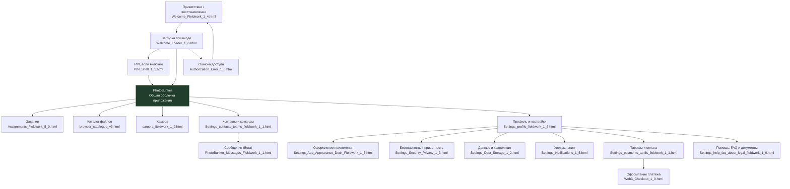
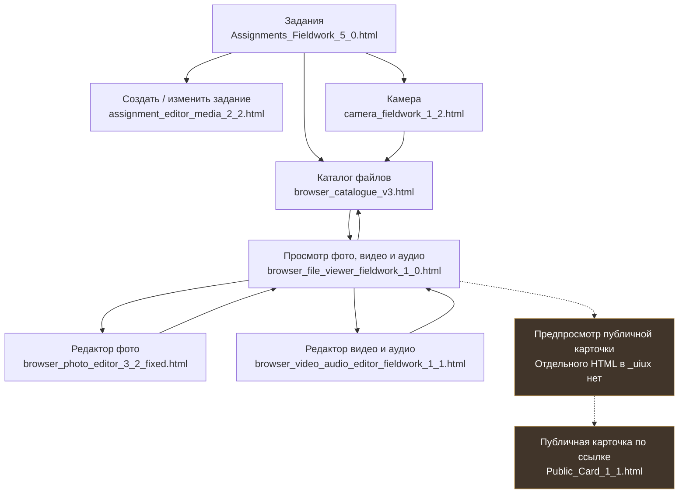
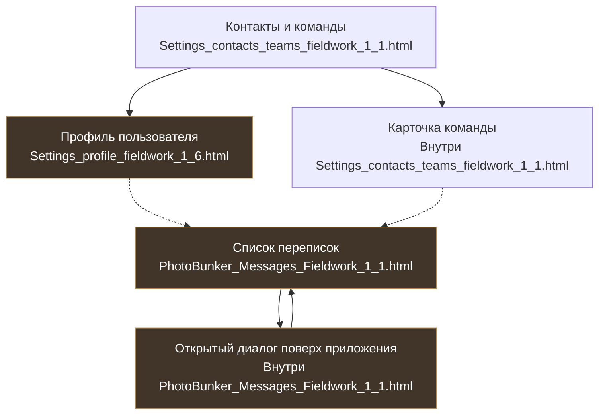

# Визуальная карта PhotoBunker 3

**Под каждым экраном указан точный файл из `docs/_uiux/`.** Ниже схем есть [кликабельный список всех файлов](#открыть-html-файлы). Файлы являются исходными UX-шаблонами, а не доказательством готовности функциональности PB3.

## Главные разделы приложения

**Главная оболочка PhotoBunker не имеет отдельного HTML в `_uiux`**: она собирается из общих Header, Dock и содержимого экранов. Актуальный макет «Данные и хранилище» — **1.2**, не сохранённый рядом старый 1.0.

## От задания до готового файла

**Предпросмотр** — это состояние внутри приложения, для которого нет отдельного HTML-файла в `_uiux`. **Публичная карточка** имеет собственный HTML, но настоящая публикация требует отдельного подтверждения прав, безопасного файла, срока ссылки и отзыва доступа.

## Контакты, профиль и сообщения

Профиль — **промежуточный, не окончательно утверждённый** дизайн. Messages — утверждённый **Beta-шаблон**. Диалог перекрывает приложение на телефоне и компьютере, но является состоянием **того же HTML**, а не отдельным файлом.

## Открыть HTML-файлы

Нажми на название файла ниже, чтобы открыть его в GitHub. Для **интерактивного просмотра** открой эти файлы через локальный HTTP-сервер из корня PB3: `python3 -m http.server 8080`, затем `http://localhost:8080/docs/_uiux/<имя файла>`.

| Экран | Файл из `docs/_uiux/` |
|---|---|
| Приветствие | [Welcome_Fieldwork_1_4.html](../_uiux/Welcome_Fieldwork_1_4.html) |
| Загрузка при входе | [Welcome_Loader_1_6.html](../_uiux/Welcome_Loader_1_6.html) |
| PIN | [PIN_Shell_1_1.html](../_uiux/PIN_Shell_1_1.html) |
| Ошибка доступа | [Authorization_Error_1_0.html](../_uiux/Authorization_Error_1_0.html) |
| Задания | [Assignments_Fieldwork_5_0.html](../_uiux/Assignments_Fieldwork_5_0.html) |
| Редактор задания | [assignment_editor_media_2_2.html](../_uiux/assignment_editor_media_2_2.html) |
| Каталог файлов | [browser_catalogue_v3.html](../_uiux/browser_catalogue_v3.html) |
| Просмотр файла | [browser_file_viewer_fieldwork_1_0.html](../_uiux/browser_file_viewer_fieldwork_1_0.html) |
| Редактирование фото | [browser_photo_editor_3_2_fixed.html](../_uiux/browser_photo_editor_3_2_fixed.html) |
| Редактирование видео / аудио | [browser_video_audio_editor_fieldwork_1_1.html](../_uiux/browser_video_audio_editor_fieldwork_1_1.html) |
| Камера | [camera_fieldwork_1_2.html](../_uiux/camera_fieldwork_1_2.html) |
| Контакты, команды и карточка команды | [Settings_contacts_teams_fieldwork_1_1.html](../_uiux/Settings_contacts_teams_fieldwork_1_1.html) |
| Профиль и настройки (WIP) | [Settings_profile_fieldwork_1_6.html](../_uiux/Settings_profile_fieldwork_1_6.html) |
| Оформление и Dock | [Settings_App_Appearance_Dock_Fieldwork_1_3.html](../_uiux/Settings_App_Appearance_Dock_Fieldwork_1_3.html) |
| Безопасность | [Settings_Security_Privacy_1_3.html](../_uiux/Settings_Security_Privacy_1_3.html) |
| Данные и хранилище | [Settings_Data_Storage_1_2.html](../_uiux/Settings_Data_Storage_1_2.html) |
| Уведомления | [Settings_Notifications_1_5.html](../_uiux/Settings_Notifications_1_5.html) |
| Тарифы | [Settings_payments_tariffs_fieldwork_1_1.html](../_uiux/Settings_payments_tariffs_fieldwork_1_1.html) |
| Оформление платежа | [Web3_Checkout_1_0.html](../_uiux/Web3_Checkout_1_0.html) |
| Помощь и документы | [Settings_help_faq_about_legal_fieldwork_1_0.html](../_uiux/Settings_help_faq_about_legal_fieldwork_1_0.html) |
| Сообщения (Beta) | [PhotoBunker_Messages_Fieldwork_1_1.html](../_uiux/PhotoBunker_Messages_Fieldwork_1_1.html) |
| Публичная карточка | [Public_Card_1_1.html](../_uiux/Public_Card_1_1.html) |

### Как читать стрелки

- **Сплошная:** переход предусмотрен согласованным интерфейсом.
- **Пунктирная:** Beta, будущая функция или отдельное решение об интеграции/доступе.

Схема **не обещает**, что все маршруты уже работают в PB3. Файлы `docs/_uiux/` остаются неизменными и доступны только для чтения; при новых версиях не перезаписываем старые эталоны.

Подробная техническая карта, если понадобится агентам: [NAVIGATION-MAP.md](NAVIGATION-MAP.md).
