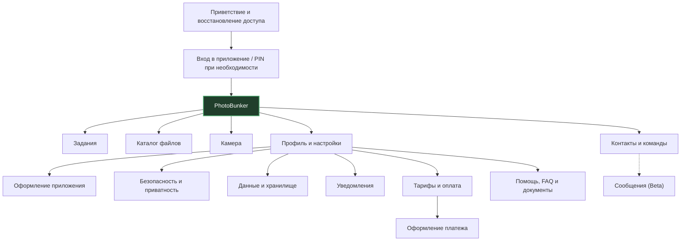
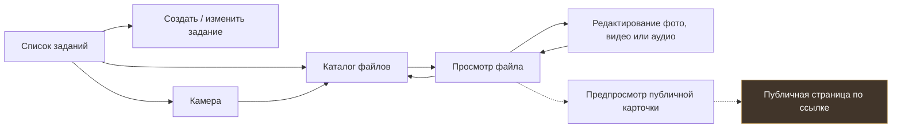
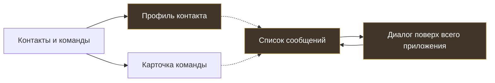

# Визуальная карта PhotoBunker 3

**Что это:** схема того, какие экраны есть в приложении и как пользователь между ними перемещается. В ней **нет технических идентификаторов**, и не нужно читать код.

> Схема отражает согласованный UX из PB2 PR #56. Это **не** заявление, что каждый экран уже работает в PB3. Профиль ещё не утверждён окончательно; сообщения — Beta, публичная публикация требует отдельного подтверждения прав.

## 1. Как устроено приложение

Пять основных разделов: **Задания, Каталог, Камера, Контакты и команды, Профиль и настройки**. В настройках пользователь может поменять набор и порядок кнопок нижней панели.

## 2. Как связаны задания, камера и файлы

**Важно:** просмотр публичной карточки — не публикация. Настоящая публичная ссылка должна создаваться отдельно, с проверкой разрешений, срока жизни и безопасной версии файла. Каталог также должен возвращать пользователя в прежнюю папку и сохранять фильтры.

## 3. Контакты и сообщения

**Здесь есть незакрытые решения:** оформление профиля ещё не окончательное, а интерфейс сообщений утверждён как Beta. Диалог должен открываться **поверх** приложения, без собственной общей шапки и Dock; при закрытии возвращаться в список сообщений с прежней прокруткой.

## 4. Что означают линии

- **Сплошная стрелка** — предусмотренный пользовательский переход в утверждённом UX.
- **Пунктир** — будущая возможность, Beta или переход, где необходимо отдельное решение о правах/интеграции.

**Даже сплошная стрелка не означает, что функциональность уже готова в PB3.** Работу конкретных переходов проверяют отдельно на реальном приложении, с настоящими E2EE-файлами и правами.

## 5. Где посмотреть реальные оригиналы экрана

Все исходные HTML лежат в [каталоге утверждённых шаблонов](../ux/README.md). Например: [Задания](../ux/assignments/v5/index.html), [Каталог](../ux/browser/index.html), [Просмотр файла](../ux/browser/viewer/index.html), [Камера](../ux/camera/index.html), [Контакты и команды](../ux/contacts-teams/index.html), [Сообщения](../ux/messages/index.html).

Для точного технического сопоставления (только разработчикам) отдельно сохранены [подробные переходы](NAVIGATION-MAP.md), [реестр шаблонов](SCREEN-REGISTRY.md) и [сценарии проверки](USER-JOURNEYS.md). Их не нужно изучать, чтобы понять эту карту.
