# Карта связей ВСЕХ HTML-файлов PhotoBunker 3

**Источник:** только `docs/_uiux/`. На схеме представлены **все 23 HTML-файла из корня этой папки**, включая старую версию Data & Storage 1.0. Папка `logo/` исключена. **Каждый прямоугольник с именем `.html` — конкретный файл**, не вновь придуманный экран.

**Это карта структуры UX и ожидаемых переходов, а не утверждение, что эти переходы уже реализованы в PB3.** Там, где HTML хранит несколько состояний одной страницы, новый файл не придумываем. Проверены [настоящие файлы](../_uiux/) и их [описания](../ux/README.md).

## Полная визуальная схема — все 23 файла

```mermaid
flowchart TB
  subgraph auth["ВХОД И ДОСТУП · без шапки и Dock приложения"]
    direction LR
    welcome["Приветствие и восстановление<br/>Welcome_Fieldwork_1_4.html"]
    loader["Состояние загрузки Welcome<br/>Welcome_Loader_1_6.html"]
    pin["Ввод обычного / экстренного PIN<br/>PIN_Shell_1_1.html"]
    autherror["Ошибка авторизации<br/>Authorization_Error_1_0.html"]
  end

  shell(["PhotoBunker · общие Header и Dock<br/>Отдельного HTML-файла в _uiux нет"])

  subgraph media["РАБОТА С ЗАДАНИЯМИ И МЕДИА"]
    direction TB
    assignments["Задания<br/>Assignments_Fieldwork_5_0.html"]
    assignmenteditor["Создание / редактирование задания<br/>assignment_editor_media_2_2.html"]
    camera["Камера<br/>camera_fieldwork_1_2.html"]
    browser["Каталог файлов<br/>browser_catalogue_v3.html"]
    viewer["Просмотр фото / видео / аудио<br/>browser_file_viewer_fieldwork_1_0.html"]
    photoeditor["Редактор фотографий<br/>browser_photo_editor_3_2_fixed.html"]
    aveditor["Редактор видео и аудио<br/>browser_video_audio_editor_fieldwork_1_1.html"]
  end

  subgraph settings["НАСТРОЙКИ · одна категория, а не самостоятельная соцсеть"]
    direction TB
    profile["Главная настроек + профиль<br/>Settings_profile_fieldwork_1_6.html"]
    contacts["Контакты и команды<br/>Settings_contacts_teams_fieldwork_1_1.html"]
    appearance["Оформление и настройка Dock<br/>Settings_App_Appearance_Dock_Fieldwork_1_3.html"]
    security["Безопасность и приватность<br/>Settings_Security_Privacy_1_3.html"]
    storage["Данные и хранилище · текущая 1.2<br/>Settings_Data_Storage_1_2.html"]
    storageold["Данные и хранилище · архив 1.0<br/>Settings_Data_Storage_1_0.html"]
    notifications["Уведомления и их настройки<br/>Settings_Notifications_1_5.html"]
    billing["Платежи и тарифы<br/>Settings_payments_tariffs_fieldwork_1_1.html"]
    checkout["Оформление платежа<br/>Web3_Checkout_1_0.html"]
    help["О приложении / FAQ / помощь / документы<br/>Settings_help_faq_about_legal_fieldwork_1_0.html"]
  end

  subgraph separate["ОТДЕЛЬНЫЙ РАЗДЕЛ · не внутри контактов"]
    messages["Сообщения · список + полноэкранный диалог, Beta<br/>PhotoBunker_Messages_Fieldwork_1_1.html"]
  end

  subgraph outside["ВНЕ АВТОРИЗОВАННОГО ПРИЛОЖЕНИЯ"]
    publiccard["Публичная карточка по ссылке<br/>Public_Card_1_1.html"]
  end

  welcome -->|"вход / восстановление"| loader
  loader -->|"если установлен PIN"| pin
  loader -->|"PIN не нужен"| shell
  pin -->|"успешная разблокировка"| shell
  loader -.->|"подтверждённая ошибка"| autherror
  autherror -->|"вернуться к приветствию"| welcome

  shell -->|"Dock"| assignments
  shell -->|"Dock"| browser
  shell -->|"Dock"| camera
  shell -->|"Профиль / Настройки"| profile

  assignments -->|"создать / изменить"| assignmenteditor
  assignments -->|"снимать по заданию"| camera
  assignments -->|"материалы задания"| browser
  camera -->|"сохранённые материалы"| browser
  browser -->|"открыть файл"| viewer
  viewer -->|"редактировать фото"| photoeditor
  viewer -->|"редактировать видео / аудио"| aveditor
  photoeditor -->|"сохранить / отменить"| viewer
  aveditor -->|"сохранить / отменить"| viewer
  viewer -->|"назад к папке"| browser

  profile -->|"профиль и люди"| contacts
  profile -->|"приложение"| appearance
  profile -->|"безопасность"| security
  profile -->|"данные"| storage
  profile -->|"уведомления"| notifications
  profile -->|"подписка"| billing
  profile -->|"информация"| help
  billing -->|"оплатить / продлить"| checkout
  storageold -.->|"СТАРАЯ ВЕРСИЯ — НЕ ПЕРЕХОД"| storage

  shell -.->|"дополнительный ярлык Dock для настроек"| contacts
  shell -.->|"если добавлены в Dock · Beta"| messages
  appearance -.->|"изменяет состав Dock"| shell

  viewer -.->|"только явная безопасная публикация"| publiccard

  classDef entry fill:#203b2d,stroke:#38a46a,color:#f5fff7,stroke-width:2px
  classDef setting fill:#273449,stroke:#7398c8,color:#f3f7ff
  classDef mediafile fill:#25372e,stroke:#6c9f80,color:#f4fff5
  classDef provisional fill:#433624,stroke:#c6a15d,color:#fff5df
  classDef archived fill:#343434,stroke:#888888,color:#dddddd,stroke-dasharray:5 4
  classDef external fill:#40372e,stroke:#aa8863,color:#fff8f0
  class shell entry
  class assignments,assignmenteditor,camera,browser,viewer,photoeditor,aveditor mediafile
  class profile,contacts,appearance,security,storage,notifications,billing,checkout,help setting
  class messages provisional
  class storageold archived
  class publiccard external
```

## На что обратить внимание при проверке схемы

**1. «Контакты и команды» относятся к настройкам.** Их родитель на схеме — `Settings_profile_fieldwork_1_6.html`, блок «Профиль и люди». В нынешнем утверждённом дизайне есть также **ярлык «Контакты» в Dock по умолчанию**. Это дополнительный способ попасть в тот же раздел, а не отдельный продукт и не «переход из Контактов в Сообщения».

**2. «Сообщения» — самостоятельный раздел**, который можно добавить в Dock через настройки оформления. В файле Messages 1.1 содержатся и список переписок, и полноэкранный диалог поверх приложения — **это не два отдельных HTML**. Кнопка «Написать» в демо карточки контакта не означает готовую навигацию в работающий мессенджер. **Стрелки из «Контактов и команд» в «Сообщения» на карте нет.**

**3. «Профиль» и «Настройки» в текущем `Settings_profile_fieldwork_1_6.html` — один HTML**, а не два файла. Профиль 1.6 пока промежуточный WIP, окончательно не утверждён.

**4. «Данные и хранилище 1.0» — архив.** Файл сохранён, поэтому присутствует на карте, но действующий эталон — `Settings_Data_Storage_1_2.html`. Пунктир между ними **не** является навигацией пользователя.

**5. «Public Card» — самостоятельная внешняя страница**, а не ещё один пункт настроек или меню Viewer. Из Viewer она достижима только после отдельного подтверждённого безопасного опубликования. Прототип не доказывает, что публикация работает в PB3.

**6. Welcome Loader — состояние экрана приветствия**, PIN и Authorization Error отображаются без авторизованного Header/Dock.

### Легенда

- **Обычная стрелка** — структура разделов или предусмотренное действие/возврат.
- **Пунктир** — опциональный пункт Dock, условная интеграция, внешний сценарий либо версия в архиве; подпись у стрелки уточняет смысл.
- **Синие прямоугольники** — настройки; **зелёные** — работа с заданиями/медиа; **жёлтый** — Beta; **серый пунктирный** — старая версия.
- **Общая оболочка** — пояснение, **не файл** в `_uiux`.

**Принцип проверки:** каждый из 23 HTML-файлов `docs/_uiux/` (кроме `logo/`) назван на этой диаграмме **ровно один раз**. Если появится новый файл или будет пропущен существующий, проверка CI должна обнаружить расхождение.

[Открыть исходную папку `docs/_uiux/`](../_uiux/) · [Утверждённые UX-спецификации](../ux/README.md) · [Технические контракты для агентов](NAVIGATION-MAP.md)
